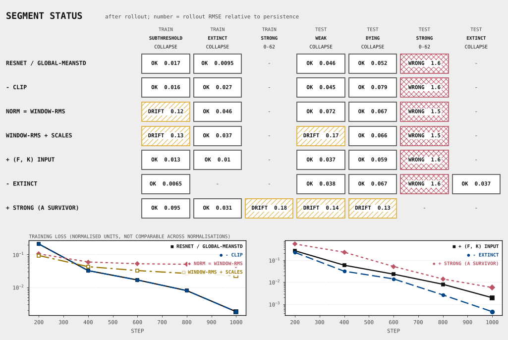
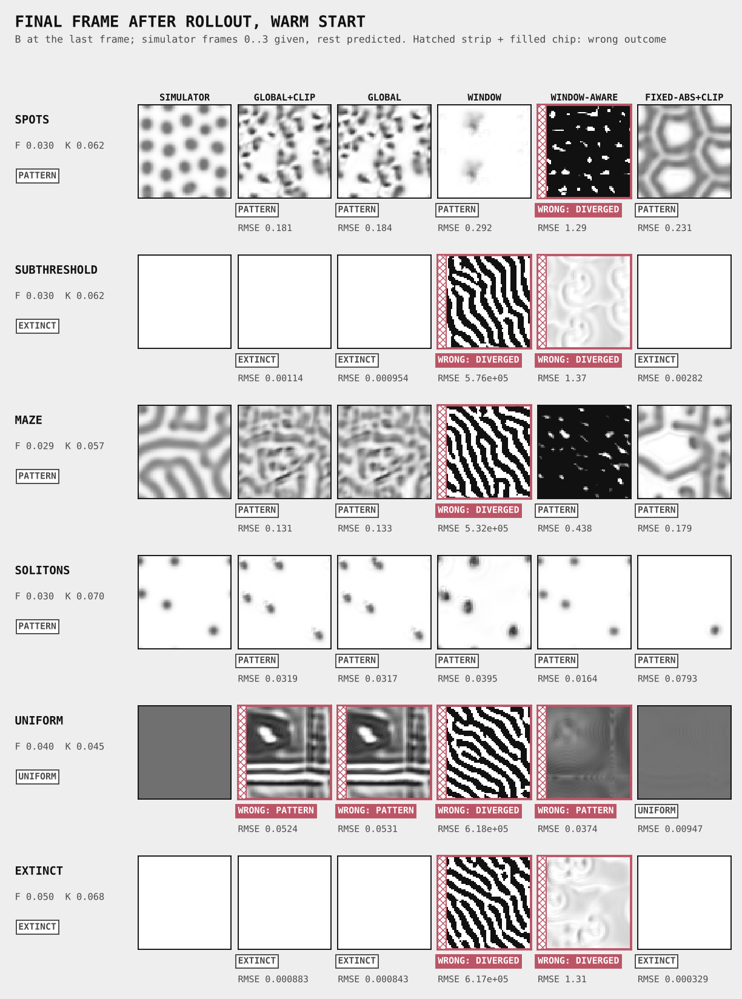
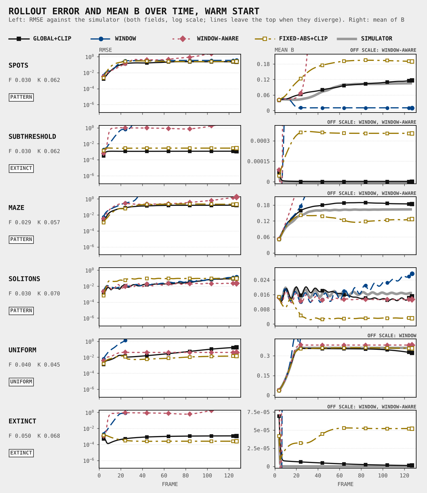
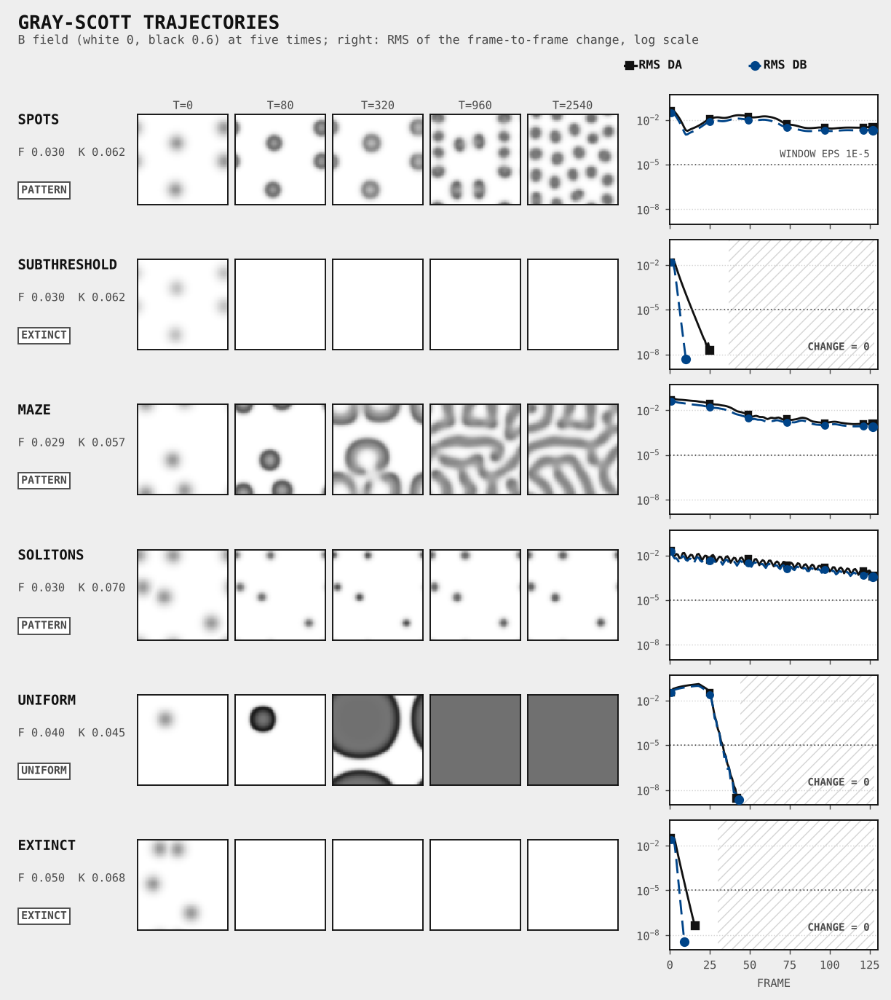

# grayscott

A Gray-Scott simulator, six trajectories with three kinds of outcome, and a
small emulator trained on them to test a question about Walrus
([arXiv:2511.15684](https://arxiv.org/abs/2511.15684)): its normalisation is
per sample and its output head is unconstrained, while Gray-Scott is
non-stationary and lives in a bounded region. What should the normalisation
and the output look like instead, without building Gray-Scott into the model?

## Status

**The models are not overfitted.** Each variant got 6000 steps at batch 8 on
2 CPU cores (76k-93k parameters). The best teacher-forced one-step error is
2-13% of the true update and no variant reproduces the `spots` or `maze`
pattern pointwise. The results describe under-fitted models, one seed each:
they show how the schemes fail, not how they rank once fitted.

## Notebook

`lab.ipynb` is the place to ask small questions: train on a few trajectories or
on parts of them (the collapses in particular), and see whether the model
learned them. It is built on `grayscott/lab.py`.

    res = lab.run(spec, data)             # can a model learn these segments?
    lab.sweep(base, data, arch=[...])     # which model?
    lab.ablate(base, data, {...})         # what if I remove / add this?

- **Models** (`arch`): `resnet`, `unet`, `fno`, and `walrus`, which builds the
  official architecture (`walrus.models.IsotropicModel`, configured like the
  released checkpoint) at any size from 1.9M parameters to the released 1.3B.
  The U-Net and the FNO are compact periodic implementations in
  `grayscott/nets.py`, not The Well's benchmark classes.
- **Normalisations** (`norm`): the four strategies of the Walrus code base
  (`window-rms`, which the released model uses, `window-meanstd`, `global-rms`,
  `global-meanstd`) and `none`, for any model.
- **Selections**: `"extinct"`, `"extinct:collapse"`, `"spots:0-60"`. New
  trajectories come from `data.add(name, F, k, amp, seed)`.
- **Verdict**: a segment is rolled out from its first `history` frames and
  scored against persistence (holding the last given frame). `OK` means the
  right outcome and a rollout RMSE below 0.1 x the persistence RMSE; otherwise
  `DRIFT`, `WRONG` (other outcome) or `DIVERGED`.

The notebook uses frames 5 time units apart, so that a collapse spans about 50
frames instead of 15. Its stored outputs come from 2 CPU cores, one seed:

| experiment (1000 steps, trained on two collapses) | training collapses | held-out collapses | held-out survivor |
|---|---|---|---|
| ResNet, `global-meanstd` | 2/2 OK (rel. RMSE 0.017, 0.010) | 2/2 OK | WRONG: predicts extinction |
| U-Net | 2/2 OK | 2/2 OK | WRONG |
| FNO | 2/2 OK (0.002) | 2/2 OK | WRONG |
| ResNet, `window-rms` | 1/2 OK, 1 DRIFT (0.12) | 2/2 OK | WRONG |
| ResNet, `window-rms` + window statistics as input | 1/2 OK, 1 DRIFT | 1/2 OK | WRONG |
| ResNet + a survivor in the training set | 2/2 OK, survivor right but DRIFT (0.18) | 0/2: right outcome, DRIFT (0.13-0.14) | (trained on) |

So at this size the collapses are learnable in minutes by all three conv nets,
including one with unseen (F, k); a model that has only seen collapses makes
everything collapse; and `window-rms` fits them less well than `global-meanstd`
at the same budget. Walrus was only run for 150 steps at its 1.9M-parameter
size (128 x 128 data, 2.7 minutes per run): no collapse learned under any of
the four normalisations, which says nothing yet. It needs a GPU.

`arch="walrus"` needs the official code:

    pip install the_well einops hydra-core timm
    pip install --no-deps git+https://github.com/PolymathicAI/walrus.git

Loading the released weights (`arch_kwargs={"size": "released", "weights":
"walrus.pt"}`) follows the official demo notebook but has not been run here.

## Dataset-agnostic variants

These know nothing about the fields, their bounds or the PDE parameters. The
model code handles any array [N, T, C, H, W]; what it uses is estimated from
the training array or from the 4-frame input window.

| variant | input | output | what it is told |
|---|---|---|---|
| `global` | (u - mean) / std, per field, over the training set | u + s raw, s = training-set delta RMS | training-set statistics; hard bounds detected in the data |
| `window` | each field / its own RMS over the input window | u + RMS(window deltas) x raw | nothing: Walrus-style |
| `window-aware` | same as `window` | same | nothing, but the two window statistics per field are also fed to the network (log10, through FiLM) |

All three read the dynamics off 4 input frames instead of receiving (F, k), use
a linear head and a squared error in their own normalised space.

Bounds are found by `data.field_stats`: the minimum or maximum of a field
counts as a hard bound when at least 1% of its values lie within 0.1% of the
range from it. On this dataset that gives A <= 1 (36% of values) and B >= 0
(50%), and nothing else. A >= 0 is a true invariant but the data never comes
near it, so it cannot be detected this way.

Warm start (simulator frames 0..3 given, frames 4..127 predicted):

| rollout | one-step error, mean (range) | outcomes | diverged on | largest excursion from the box |
|---|---|---|---|---|
| `global+clip` | 0.07 (0.02-0.13) | 5/6 | none | 0.035 |
| `global` | same model | 5/6 | none | 0.14 |
| `window` | 0.24 (0.09-0.44) | 2/6 | subthreshold, maze, uniform, extinct | diverged |
| `window+clip` | same model | 1/6 | all but solitons | diverged |
| `window-aware` | 0.11 (0.06-0.23) | 2/6 | spots, subthreshold, extinct | 24 |
| `window-aware+clip` | same model | 2/6 | spots | 3.1 |
| `fixed-abs+clip` (Gray-Scott-specific reference) | 0.09 (0.02-0.15) | 6/6 | none | 0.015 |

Mean rollout RMSE (wrong outcome in brackets):

| | spots | subthreshold | maze | solitons | uniform | extinct |
|---|---|---|---|---|---|---|
| `global+clip` | 0.18 | 0.0011 | 0.13 | 0.032 | 0.052 (pattern) | 0.00088 |
| `window` | 0.29 | diverged | diverged | 0.040 | diverged | diverged |
| `window-aware` | diverged | diverged | 0.44 | 0.016 | 0.037 (pattern) | diverged |
| `fixed-abs+clip` | 0.23 | 0.0028 | 0.18 | 0.079 | 0.0095 | 0.00033 |

One-step error: sqrt(sum |pred - target|^2 / sum |target - previous|^2) over a
trajectory, teacher-forced. "Outcome" is the class of the last frame (pattern /
uniform / extinct) against the simulator; for a pattern it only says that some
pattern is there. A rollout whose prediction exceeds 10 anywhere is scored as
diverged. "Excursion" is how far an unprojected prediction left the exact box
A in [0,1], B >= 0.

What these runs show:

1. **`global` is the general variant that works.** It never diverges, holds
   both extinct trajectories (RMSE about 1e-3) and gets five outcomes right.
   Its patterns are the closest so far in bulk: final mean B is 0.116 against
   0.105 on `spots`, 0.184 against 0.164 on `maze`, 0.015 against 0.017 on
   `solitons`. They are still not the simulator's patterns pointwise.
2. **It fails on `uniform`.** The field reaches the uniform state by frame 30
   (RMSE 0.01), then loses it slowly: the error grows to 0.17 by the last
   frame and structure appears (final mean B 0.32 against 0.36). The
   Gray-Scott-specific reference holds that state.
3. **Its rollout error is below the Gray-Scott-specific reference on four
   trajectories** (spots, subthreshold, maze, solitons) and above it on
   uniform and extinct. The two
   differ in three ways at once (4 input frames instead of 1, no (F, k),
   standardised inputs instead of (1 - A, B)), so the gain cannot be assigned
   to one of them.
4. **Per-window statistics without (F, k) are unstable here.** `window`
   diverges on four trajectories between frames 23 and 35. Yesterday's
   `samplewise` run, the same scheme with (F, k) as an input, diverged on one.
5. **Telling the network the window statistics helps the fit, not the
   rollout.** `window-aware` ends with a 4x lower training loss than `window`
   (0.008 against 0.034) and the best RMSE on `solitons`, but it still grows B
   out of the two decayed states, and on `spots` and `maze` B keeps growing
   (final mean 8.0 and 2.1 against 0.105 and 0.164).
6. **Detected bounds are enough for the projection.** With them `global` stays
   within 0.035 of the exact box; without, within 0.14. The projection does not
   rescue the window variants.

`global` needs one pass over a training set to get its statistics. It is not an
answer for the setting Walrus's choice was made for, where a dataset may have
too few trajectories for stable statistics; `window-aware` is the variant for
that setting, and here it is not enough.

## Gray-Scott-specific reference variants

The first round of runs used Gray-Scott knowledge: inputs (1 - A, B) so that
the trivial state is exactly zero, the exact box A in [0,1], B >= 0, and
(F, k) as a FiLM input. They are Markov (1 input frame), except `samplewise`.

| variant | output | loss |
|---|---|---|
| `fixed-abs` | u + s raw, s = dataset delta RMS | squared error / s |
| `fixed` | u + e sinh(raw), e = 0.1 s | squared error in asinh(delta / e) |
| `fixed-pd` | production-destruction update | same as `fixed` |
| `fixed-linear` | u + s raw | squared error / (RMS of the true delta + e), per sample |
| `samplewise` | per-window statistics, as `window` | squared error in that space |

| rollout | one-step error, mean (range) | outcomes, warm | outcomes, cold | diverged on, warm | largest excursion, warm |
|---|---|---|---|---|---|
| `fixed-abs+clip` | 0.09 (0.02-0.15) | 6/6 | 6/6 | none | 0.015 |
| `fixed-abs` | same model | 6/6 | | none | 0.075 |
| `fixed-pd` | 0.22 (0.13-0.48) | 5/6 | 5/6 | none | 0 |
| `fixed+clip` | 0.23 (0.17-0.31) | 4/6 | 4/6 | none | 0.22 |
| `fixed` | same model | 5/6 | | none | 0.40 |
| `fixed-linear+clip` | 0.16 (0.06-0.26) | 4/6 | 5/6 | none | 0.027 |
| `fixed-linear` | same model | 2/6 | | spots, maze | diverged |
| `samplewise` | 0.17 (0.07-0.35) | 4/6 | | subthreshold | 279 |
| `samplewise+clip` | same model | 3/6 | | subthreshold, maze | diverged |

Cold start: only frame 0 is given, which only Markov models can do. What that
round showed:

- Plain dataset units with a plain squared error (`fixed-abs`) gave the lowest
  one-step error and the only fully correct set of outcomes. Its patterns were
  wrong: `spots` became a honeycomb network (final mean B 0.19 against 0.105).
- The relative-precision ideas (sinh head with an asinh loss, per-sample
  relative loss, production-destruction head) all ended with a higher one-step
  error at this budget, and the first and last let `spots` die out from a
  warm start.
- The production-destruction head never leaves the box, by construction:

      A+ = A (1 - d_A) + (1 - A) p_A
      B+ = B (1 - d_B) + s_B

  with p, d = 1 - exp(-softplus(raw)) in [0, 1) and s_B >= 0.
- The projection matters for stability: `fixed-linear` diverges on `spots` and
  `maze` without it.
- `samplewise` nucleated B out of the decayed `subthreshold` state and
  diverged, froze on `spots` (mean B 0.051 against 0.105) and overshot on
  `uniform` (0.41 against 0.36).

Two properties of the data, independent of training:

- At t = 0 the per-window-RMS-scaled B field of `spots` and `subthreshold` is
  the same to 3e-7; only the depth of the A dip (0.50 against 0.30 of the
  background) tells them apart.
- With 4-frame windows, 32% of windows have RMS(B) below the 1e-5 floor and
  43-44% have RMS(delta) below it; the largest single-pixel delta is 22-27
  times the dataset delta RMS.

## The system

    dA/dt = D_A lap(A) - A B^2 + F (1 - A)
    dB/dt = D_B lap(B) + A B^2 - (F + k) B

`grayscott/sim.py`: periodic 64x64 grid, dx = 1, 5-point Laplacian, explicit
Euler with D_A = 0.2, D_B = 0.1, dt = 0.5. The scheme is monotone at this time
step, so the discrete solution keeps the exact invariants of the PDE:

- A in [0, 1] and B >= 0 pointwise,
- mean(A + B) <= 1.

Pointwise A + B <= 1 is not an invariant when D_A != D_B and is not enforced
anywhere (it did hold in all six trajectories). Frames are 20 time units apart,
128 frames per trajectory.

| name | F | k | seed amplitude | outcome |
|---|---|---|---|---|
| spots | 0.030 | 0.062 | 1.0 | pattern (self-replicating spots) |
| subthreshold | 0.030 | 0.062 | 0.6 | extinct |
| maze | 0.029 | 0.057 | 1.0 | pattern (labyrinth) |
| solitons | 0.030 | 0.070 | 1.0 | pattern (a few isolated spots) |
| uniform | 0.040 | 0.045 | 1.0 | uniform non-trivial state |
| extinct | 0.050 | 0.068 | 1.0 | extinct |

`spots` and `subthreshold` share (F, k) and the layout of the initial bumps;
only the bump amplitude differs. The trivial state A = 1, B = 0 is linearly
stable, so the fate is decided by an absolute amplitude threshold (between 0.6
and 0.8 here).

## Common to every variant

One backbone for the runs above (`grayscott/nets.py`): a periodic ResNet, 4 blocks, width 32,
with no normalisation layers (a spatial norm inside the network would divide
the amplitude out again). `+clip` means the state fed back is projected on the
model's bounds; the loss always sees the unprojected prediction.

The window scheme follows the released Walrus code
(`RMSSamplewiseRevNormalization`, commit 73f2cf6): RMS over time and space per
sample and field, floored with `max(., 1e-5)`, statistics not differentiated
through, delta prediction. Deliberate differences from Walrus: the conv
backbone, 4 input frames instead of 10, and squared error instead of MAE (with
MAE and a zero-initialised head, none of the three variants tried had moved
after 600-800 steps).

Training draws (trajectory, frame) pairs uniformly, except that frames after
which nothing changes any more are drawn at 10% of the rate. Adam, batch 8,
6000 steps, cosine schedule from 1e-3, single-step loss. `--unroll K` and
`--init RUN` (continue from a checkpoint) exist but were not used for the
reported runs.

Outcome of a last frame, same rule for simulator and emulator: pattern if
std B >= 0.01; otherwise extinct if mean B < 0.01, else uniform.

## Run it

    pip install -e .[dev,lab]
    pytest
    jupyter lab lab.ipynb       # the notebook
    ./run_all.sh                # data, the 3 dataset-agnostic runs, evaluation, figures

or step by step (`data/` is not in the repository; the first line regenerates
it, deterministically, in a few seconds):

    python -m grayscott.data
    python -m grayscott.train --variant global          # or window, window-aware
    python -m grayscott.train --variant fixed-abs       # Gray-Scott-specific reference
    python -m grayscott.evaluate                        # every runs/<variant> that exists

The reported runs took 22 to 36 minutes each on 2 CPU cores, two or three at a
time. To actually fit the trajectories the obvious levers are more steps and a
wider network on a GPU, then unrolled fine-tuning:

    python -m grayscott.train --variant global --device cuda --steps 100000 --width 64 --blocks 6
    python -m grayscott.train --variant global --device cuda --init runs/global --unroll 4 --steps 20000 --lr 2e-4
    python -m grayscott.evaluate --device cuda

`--device cuda` is plain `.to(device)` code and has not been run on a GPU here.

## Layout

    grayscott/sim.py        simulator, initial conditions, outcome classifier
    grayscott/data.py       presets, dataset generation, generic field statistics
    grayscott/nets.py       resnet, unet, fno, walrus adapter
    grayscott/model.py      normalisation schemes, heads, losses, rollout
    grayscott/train.py      training loop and variants
    grayscott/evaluate.py   rollouts, metrics, tables
    grayscott/plots.py      figures
    grayscott/lab.py        notebook harness: data selection, run, sweep, ablate, compare
    grayscott/labplots.py   notebook figures
    lab.ipynb               the notebook, with outputs
    tests/                  pytest
    runs/ results/          checkpoints, metrics and figures of the reported runs
    data/                   generated dataset (git-ignored)
